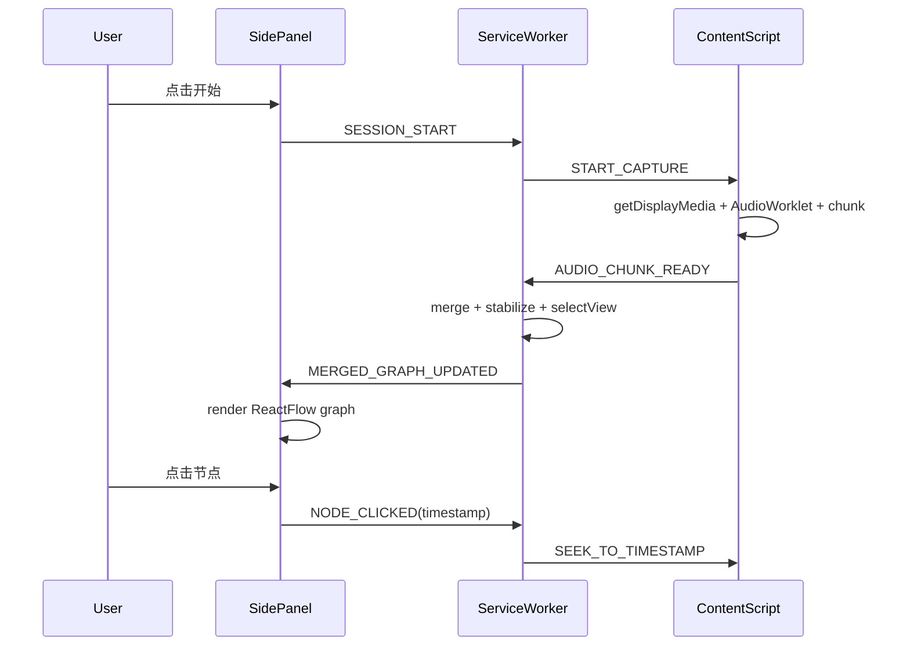

下面给你一版**更工程化、可直接开工的技术设计文档 v1**。
我按“先做浏览器插件 / Web Demo，后续平滑演进桌面端和移动端”的路线来写，尽量覆盖：

* 仓库结构
* 模块职责
* 数据模型
* Provider 接口
* 插件消息流
* 数据流时序
* Renderer 设计
* 存储设计
* 配置与安全
* 测试与里程碑

---

# Listen Graphic 技术设计文档 v1

## 1. 文档目标

本文档用于指导 Listen Graphic 第一阶段工程实现，目标是：

1. 先以 **Web Demo / 浏览器插件** 跑通最小闭环
2. 保证核心领域层可复用，后续可平滑扩展到：

   * 桌面端（Tauri）
   * 移动端（Expo / React Native）
3. 避免早期技术债，特别是：

   * 模型耦合
   * 图组件耦合
   * 平台壳耦合
   * 数据协议混乱

---

## 2. 总体技术目标

第一阶段系统需要完成以下闭环：

1. 获取音频输入
2. 进行 chunk 化处理
3. 调用 ASR 获得 transcript
4. 调用结构抽取模块生成中间结构 `SegmentGraph`
5. 执行 merge / stabilization
6. 根据规则选择默认视图
7. 渲染为交互式图
8. 支持点击节点回跳音频时间戳
9. 本地保存会话与导出结果

---

## 3. 非目标（V1 不做）

第一阶段明确不做：

* 逐句级强实时更新
* 重本地 ASR / 本地大模型推理
* 复杂多说话人高精度可视化
* 跨平台统一 UI 代码
* 公共播客内容抓取与聚合库
* 多人协作
* 云端账号体系与同步

---

## 4. 架构总览

## 4.1 分层架构

```text
Shell Layer
├─ Web Demo
├─ Browser Extension
├─ Desktop (future)
└─ Mobile (future)

Application Layer
├─ Session Orchestrator
├─ Audio Pipeline
├─ Transcript Pipeline
├─ Structuring Pipeline
├─ Graph Pipeline
└─ Export Pipeline

Domain Layer
├─ Schema
├─ Chunking
├─ Merge
├─ Stabilization
├─ View Selection
└─ Renderer Input Mapper

Provider Layer
├─ ASR Providers
├─ LLM Structurer Providers
└─ Speaker Providers

Infra Layer
├─ Storage
├─ Messaging
├─ Logging
├─ Telemetry
└─ Config / Secrets
```

## 4.2 核心原则

* **平台壳薄，领域层厚**
* **模型调用抽象成 provider**
* **UI 不直接消费原始 transcript，只消费结构化 graph**
* **图只是 IR 的视图，不是主数据**
* **先保证可回放、可调试、可落盘**

---

## 5. 仓库结构

建议 monorepo：

```text
listen-graphic/
├─ apps/
│  ├─ web-demo/
│  ├─ extension/
│  ├─ desktop/          # future
│  └─ mobile/           # future
├─ packages/
│  ├─ schema/
│  ├─ domain/
│  ├─ providers/
│  ├─ graph-renderers/
│  ├─ prompt-kit/
│  ├─ storage/
│  ├─ ui/
│  └─ shared-utils/
├─ docs/
│  ├─ tech-design.md
│  ├─ prompt-spec.md
│  ├─ message-protocol.md
│  └─ data-model.md
├─ scripts/
├─ pnpm-workspace.yaml
└─ turbo.json
```

### 工具建议

* 包管理：`pnpm`
* Monorepo：`turborepo`
* 代码规范：`eslint + prettier`
* 类型校验：`typescript`
* runtime schema：`zod`

---

## 6. 包与模块职责

## 6.1 `packages/schema`

只放领域协议与类型定义，不放业务逻辑。

包含：

* node / edge 类型
* transcript 类型
* graph 类型
* export 类型
* provider 输入输出类型
* zod schema

---

## 6.2 `packages/domain`

核心业务逻辑，跨平台共用。

包含：

* chunk 切分
* topic segmentation
* graph merge
* graph stabilization
* view selection
* renderer input mapping
* 导出映射

---

## 6.3 `packages/providers`

抽象 AI 能力接入。

包含：

* ASR provider
* structurer provider
* speaker provider
* provider factory
* provider config validator

---

## 6.4 `packages/graph-renderers`

只处理图形渲染相关逻辑。

包含：

* React Flow renderer
* dagre layout adapter
* Mermaid exporter
* ECharts summary adapter

---

## 6.5 `packages/storage`

封装本地存储。

包含：

* IndexedDB DAO
* session repository
* settings repository
* export repository

---

## 6.6 `packages/prompt-kit`

管理 Prompt 版本与模板。

包含：

* structuring prompt
* chunk summary prompt
* merge assist prompt（可选）
* strict JSON schema prompt
* prompt version registry

---

## 6.7 `apps/extension`

浏览器插件壳。

包含：

* sidepanel UI
* background/service worker
* offscreen document
* content script
* options page

---

## 6.8 `apps/web-demo`

最小可运行 Demo，验证结构视图价值。

---

## 7. 核心数据模型

---

## 7.1 基础枚举

```ts
export type NodeType =
  | "claim"
  | "reason"
  | "example"
  | "question"
  | "conclusion";

export type EdgeType =
  | "supports"
  | "opposes"
  | "causes"
  | "follows"
  | "example_of";

export type GraphNodeStatus = "draft" | "confirmed";

export type ViewType =
  | "timeline"
  | "causal"
  | "comparison"
  | "flow"
  | "hierarchy";
```

---

## 7.2 Transcript 模型

```ts
export interface AudioChunkMeta {
  chunkId: string;
  sessionId: string;
  startMs: number;
  endMs: number;
  sampleRate: number;
  channelCount: number;
  source: "tab" | "file" | "mic";
  createdAt: number;
}

export interface TranscriptToken {
  text: string;
  startMs?: number;
  endMs?: number;
  speaker?: string;
  confidence?: number;
}

export interface TranscriptChunk {
  chunkId: string;
  sessionId: string;
  text: string;
  startMs: number;
  endMs: number;
  tokens?: TranscriptToken[];
  speakerHints?: string[];
  provider: string;
  confidence?: number;
  raw?: unknown;
}
```

---

## 7.3 中间结构模型

```ts
export interface GraphNode {
  id: string;
  type: NodeType;
  text: string;
  speaker?: string;
  timestampMs: number;
  confidence?: number;
  status: GraphNodeStatus;
  topicId?: string;
  evidenceChunkIds?: string[];
}

export interface GraphEdge {
  id: string;
  source: string;
  target: string;
  type: EdgeType;
  confidence?: number;
  evidenceChunkIds?: string[];
}

export interface SegmentGraph {
  segmentId: string;
  sessionId: string;
  startMs: number;
  endMs: number;
  topic?: string;
  nodes: GraphNode[];
  edges: GraphEdge[];
  provider: string;
  raw?: unknown;
}
```

---

## 7.4 合并后图模型

```ts
export interface MergedGraph {
  sessionId: string;
  revision: number;
  topics: Array<{
    topicId: string;
    title: string;
    startMs: number;
    endMs: number;
  }>;
  nodes: GraphNode[];
  edges: GraphEdge[];
  viewHints?: {
    defaultView?: ViewType;
    scores?: Partial<Record<ViewType, number>>;
  };
  updatedAt: number;
}
```

---

## 7.5 Renderer 输入模型

```ts
export interface RendererNode {
  id: string;
  label: string;
  type: NodeType;
  speaker?: string;
  timestampMs: number;
  status: GraphNodeStatus;
  importance?: number;
}

export interface RendererEdge {
  id: string;
  source: string;
  target: string;
  relation: EdgeType;
}

export interface RendererGraph {
  viewType: ViewType;
  nodes: RendererNode[];
  edges: RendererEdge[];
  meta?: {
    currentTimeMs?: number;
    highlightedNodeIds?: string[];
  };
}
```

---

## 8. Provider 抽象设计

## 8.1 Provider 接口

```ts
export interface AsrProvider {
  name: string;
  transcribeChunk(input: {
    audio: Blob | ArrayBuffer;
    startMs: number;
    endMs: number;
    sessionId: string;
    language?: string;
  }): Promise<TranscriptChunk>;
}

export interface StructurerProvider {
  name: string;
  extractSegmentGraph(input: {
    sessionId: string;
    transcriptWindow: TranscriptChunk[];
    previousGraph?: MergedGraph;
    language?: string;
  }): Promise<SegmentGraph>;
}

export interface SpeakerProvider {
  name: string;
  labelSpeakers?(input: {
    chunks: TranscriptChunk[];
    audioRefs?: string[];
  }): Promise<
    Array<{
      chunkId: string;
      speaker: string;
      confidence?: number;
    }>
  >;
}
```

---

## 8.2 Provider Factory

```ts
export interface ProviderConfig {
  asr: {
    type: string;
    apiKey?: string;
    endpoint?: string;
    model?: string;
  };
  structurer: {
    type: string;
    apiKey?: string;
    endpoint?: string;
    model?: string;
  };
  speaker?: {
    type: string;
    apiKey?: string;
    endpoint?: string;
    model?: string;
  };
}
```

```ts
export interface ProviderRegistry {
  getAsrProvider(config: ProviderConfig["asr"]): AsrProvider;
  getStructurerProvider(config: ProviderConfig["structurer"]): StructurerProvider;
  getSpeakerProvider?(config?: ProviderConfig["speaker"]): SpeakerProvider | null;
}
```

---

## 8.3 设计要求

* Provider 之间必须可替换
* 不允许业务代码直接依赖某家 SDK
* Provider 的 raw response 统一放 `raw` 字段，供调试，不进 UI

---

## 9. Prompt 设计规范

## 9.1 Prompt 目标

Structurer prompt 的目标不是画图，而是生成**严格 JSON**。

## 9.2 Prompt 输出要求

* 只能输出 JSON
* 节点类型只能是允许枚举
* 边类型只能是允许枚举
* 每个节点必须带 `timestampMs`
* 尽量附带 `speaker`
* 不能输出解释文字

## 9.3 Prompt 版本管理

建议在 `packages/prompt-kit` 中按版本管理：

```ts
export interface PromptSpec {
  id: string;           // e.g. structurer_v1
  version: string;      // e.g. 1.0.0
  description: string;
  template: string;
}
```

### 推荐策略

* prompt 版本固定
* 每次线上切换先灰度
* 结果落盘时写入 prompt version

---

## 10. 音频处理链路设计

## 10.1 插件端链路

当前仓库的插件实现已先收口到一条更稳的链路，作为 V1 的实际运行方案：

```text
sidepanel
  -> service worker
  -> content script
  -> getDisplayMedia
  -> AudioWorklet
  -> chunk flush
  -> mock ASR / structurer
  -> merge + stabilize + defaultView
  -> sidepanel render + node seek
```

`tabCapture + offscreen document` 仍保留为后续演进方向，但当前不作为已接通主链路；这样能避免同时维护两套 background/message 流程。

```text
tab audio
  -> tabCapture
  -> offscreen document
  -> AudioContext
  -> AudioWorklet
  -> PCM frames / chunk buffer
  -> chunk flush
  -> ASR provider
  -> transcript chunk
```

## 10.2 Chunk 策略

V1 建议：

* chunk 时长：30s
* flush 条件：

  * 达到 30s
  * 静音超过阈值
  * 用户主动停止
* 每个 chunk 附带：

  * startMs
  * endMs
  * sessionId
  * source

## 10.3 VAD 策略

V1 不做复杂 VAD，先用轻量阈值：

* RMS 能量阈值
* 静音区间阈值 800ms ~ 1500ms
* 仅用于优化 flush，不参与语义切 topic

---

## 11. Structuring Pipeline 设计

## 11.1 流程

1. 收到一个或多个 transcript chunk
2. 按 window 聚合（如最近 2~3 个 chunk）
3. 调用 structurer provider
4. 生成 `SegmentGraph`
5. 进入 merge pipeline

## 11.2 Window 策略

V1 建议：

* 每次输入：最近 2~3 个 transcript chunk
* 可带最近合并图摘要（可选）
* 避免输入过长导致成本和噪声上升

---

## 12. Merge Pipeline 设计

## 12.1 目标

将 chunk 级 `SegmentGraph` 合并成 session 级 `MergedGraph`。

## 12.2 Merge 规则（V1）

先做简单规则，不上复杂 embedding：

### 节点合并

满足以下条件之一可候选合并：

* 相同 `type`
* 文本归一化后高度相似
* speaker 相同或为空
* 时间接近
* topic 相近

### 归一化建议

* 去标点
* 统一大小写
* 去常见口语填充词
* 中文数字 / 阿拉伯数字做简单归一

### 边合并

* `source + target + type` 相同时合并
* 保留最高 confidence
* evidenceChunkIds 合并去重

---

## 12.3 Merge 伪代码

```ts
function mergeSegmentGraph(prev: MergedGraph, next: SegmentGraph): MergedGraph {
  const mergedNodes = mergeNodes(prev.nodes, next.nodes);
  const mergedEdges = mergeEdges(prev.edges, next.edges, mergedNodes);
  const topics = mergeTopics(prev.topics, next);

  return {
    ...prev,
    revision: prev.revision + 1,
    nodes: mergedNodes,
    edges: mergedEdges,
    topics,
    updatedAt: Date.now(),
  };
}
```

---

## 13. Stabilization 设计

## 13.1 目的

减少“图抖动”。

## 13.2 节点状态策略

* 新节点默认 `draft`
* 满足以下条件之一转 `confirmed`：

  * 连续 2 次 merge 后仍存在
  * confidence 超阈值
  * 其所在 topic 已结束
* `confirmed` 节点尽量不重命名、不重定位大改

## 13.3 删除策略

V1 不主动删除 confirmed 节点，只允许：

* 降低可见性
* 标记 stale
* 在视图层折叠

这样更稳。

---

## 14. View Selection 设计

## 14.1 目标

自动判断默认视图。

## 14.2 简单打分策略

```ts
function scoreView(graph: MergedGraph): Record<ViewType, number> {
  const scores = {
    timeline: 0,
    causal: 0,
    comparison: 0,
    flow: 0,
    hierarchy: 0,
  };

  for (const edge of graph.edges) {
    if (edge.type === "follows") {
      scores.timeline += 2;
      scores.flow += 2;
    }
    if (edge.type === "causes") {
      scores.causal += 3;
    }
    if (edge.type === "opposes") {
      scores.comparison += 3;
    }
    if (edge.type === "supports") {
      scores.causal += 1;
      scores.hierarchy += 1;
    }
    if (edge.type === "example_of") {
      scores.hierarchy += 2;
    }
  }

  return scores;
}
```

## 14.3 默认视图逻辑

* 取最高分
* 平分时优先：
  `comparison > causal > timeline > flow > hierarchy`

---

## 15. Renderer 设计

## 15.1 主渲染框架

* React Flow：主画布
* dagre：自动布局
* Mermaid：导出

---

## 15.2 Renderer 模式

```ts
export interface GraphRenderer {
  viewType: ViewType;
  toRendererGraph(input: MergedGraph): RendererGraph;
}
```

### 实现类

* `TimelineRenderer`
* `CausalRenderer`
* `ComparisonRenderer`
* `FlowRenderer`
* `HierarchyRenderer`

---

## 15.3 节点 UI 规范

节点统一使用 React 组件卡片：

字段：

* label
* type badge
* speaker
* timestamp
* status
* optional confidence

交互：

* click：跳转时间
* hover：显示 evidence
* active：当前播放位置高亮
* status=draft：弱色显示

---

## 15.4 布局规范

### Timeline

* 横向排列
* 依据 timestamp 排序

### Causal

* 自上而下
* cause 在上，effect 在下

### Comparison

* 左右分栏
* speaker 或立场分组

### Flow

* 单向步骤流
* follows 关系驱动

### Hierarchy

* 树状排布
* claim 为主干，reason/example 挂载

---

## 16. 导出设计

## 16.1 支持格式

V1 只支持：

* JSON
* Markdown
* PNG
* Mermaid 文本

## 16.2 导出职责

在 `packages/domain/exporters` 中做映射：

```ts
export interface Exporter<T> {
  export(graph: MergedGraph): T;
}
```

### 实现

* `JsonExporter`
* `MarkdownExporter`
* `MermaidExporter`
* `PngExporter`（通过前端截图/画布导出）

---

## 17. 插件消息流设计

## 17.1 主要进程

* sidepanel
* service worker
* content script

补充说明：当前落地版本中，`offscreen` 仍保留在仓库里，但不参与主链路；真正运行的是 `sidepanel <-> service worker <-> content script`。

## 17.2 Message 类型定义

```ts
export type AppMessage =
  | { type: "SESSION_START"; target: "service-worker"; payload: { tabId: number } }
  | { type: "SESSION_STOP"; target: "service-worker"; payload: { sessionId: string } }
  | { type: "SESSION_STATE_CHANGED"; target: "sidepanel"; payload: { sessionId: string | null; state: SessionState } }
  | { type: "AUDIO_CHUNK_READY"; target: "service-worker"; payload: { audioData: number[]; startMs: number; endMs: number } }
  | { type: "TRANSCRIPT_READY"; target: "sidepanel"; payload: { transcript: TranscriptChunk } }
  | { type: "MERGED_GRAPH_UPDATED"; target: "sidepanel"; payload: { graph: MergedGraph } }
  | { type: "NODE_CLICKED"; target: "service-worker"; payload: { sessionId: string; nodeId: string; timestampMs: number } }
  | { type: "PLAYBACK_TIME_UPDATED"; target: "sidepanel"; payload: { currentTimeMs: number } }
  | { type: "ERROR"; target: "sidepanel"; payload: { code: string; message: string } };
```

---

## 17.3 插件消息时序



---

## 18. Session Orchestrator 设计

## 18.1 职责

统一调度一次收听会话。

### 状态机

```ts
type SessionState =
  | "idle"
  | "capturing"
  | "transcribing"
  | "structuring"
  | "rendering"
  | "paused"
  | "stopped"
  | "error";
```

## 18.2 Orchestrator 接口

```ts
interface SessionOrchestrator {
  start(input: { tabId?: number; file?: File }): Promise<void>;
  stop(): Promise<void>;
  pause(): Promise<void>;
  resume(): Promise<void>;
  getState(): SessionState;
}
```

---

## 19. 存储设计

## 19.1 IndexedDB 表设计

### `settings`

```ts
{
  key: string;
  value: unknown;
}
```

### `sessions`

```ts
{
  sessionId: string;
  sourceType: "tab" | "file";
  createdAt: number;
  endedAt?: number;
  title?: string;
  providerConfigRef?: string;
}
```

### `transcript_chunks`

```ts
{
  chunkId: string;
  sessionId: string;
  startMs: number;
  endMs: number;
  text: string;
  speakerHints?: string[];
  provider: string;
  raw?: unknown;
}
```

### `segment_graphs`

```ts
{
  segmentId: string;
  sessionId: string;
  revision: number;
  startMs: number;
  endMs: number;
  graph: SegmentGraph;
}
```

### `merged_graphs`

```ts
{
  sessionId: string;
  revision: number;
  graph: MergedGraph;
  updatedAt: number;
}
```

### `exports`

```ts
{
  exportId: string;
  sessionId: string;
  type: "json" | "markdown" | "png" | "mermaid";
  content: Blob | string;
  createdAt: number;
}
```

---

## 20. 配置与安全

## 20.1 API Key 原则

V1 若支持用户自带 Key：

* 仅保存在本地
* 默认 IndexedDB / local-only storage
* 不进入 sync
* 提供一键清除
* UI 明确提示“本地保存，风险自担”

## 20.2 Provider Secret 管理

若后续引入托管模式：

* 真正 secret 放服务端
* 客户端只持 session token
* provider 请求尽量从后端中转

---

## 21. 错误处理与降级

## 21.1 错误分类

* `CAPTURE_ERROR`
* `TRANSCRIBE_ERROR`
* `STRUCTURE_ERROR`
* `MERGE_ERROR`
* `RENDER_ERROR`
* `STORAGE_ERROR`
* `SEEK_ERROR`

## 21.2 降级策略

### ASR 失败

* 保留 chunk
* 提示可重试

### Structurer 失败

* 允许继续累计 transcript
* 提示“仅显示逐字稿 / 暂无结构图”

### Renderer 失败

* 回退到节点列表视图
* 保证 session 不崩

### Seek 失败

* 保留节点点击事件日志
* 允许用户复制时间戳

---

## 22. 日志与可观测性

## 22.1 最低限度日志

建议记录：

* session 开始/结束
* chunk flush
* ASR 调用耗时
* structuring 调用耗时
* merge revision
* renderer render 耗时
* 节点点击
* 导出

## 22.2 Debug 面板

V1 强烈建议做隐藏 debug 面板，显示：

* 当前 sessionId
* 当前 chunk 列表
* 最近 transcript
* 最近 segment graph
* merged graph revision
* 当前 view scores
* provider 响应耗时
* 错误堆栈

这个对早期调试非常重要。

---

## 23. 测试策略

## 23.1 单元测试

覆盖：

* 文本归一化
* 节点合并
* 边合并
* stabilization 规则
* view selection
* exporter

## 23.2 集成测试

覆盖：

* transcript window -> SegmentGraph
* multi-segment merge -> MergedGraph
* MergedGraph -> RendererGraph
* 节点点击 -> seek event

## 23.3 E2E

插件 E2E 可后置，Web Demo 先做：

* 导入音频
* 模拟 transcript
* 验证图生成
* 验证时间跳转

---

## 24. 开发阶段建议

## 24.1 Sprint 1：Schema + Domain

产出：

* `packages/schema`
* `packages/domain` 初版
* mock transcript -> graph -> render 跑通

## 24.2 Sprint 2：Web Demo

产出：

* 导入 transcript / mock 数据
* React Flow 图渲染
* 视图切换
* 节点跳转模拟

## 24.3 Sprint 3：Extension 基础壳

产出：

* sidepanel
* service worker
* offscreen
* start/stop session
* 本地存储

## 24.4 Sprint 4：真链路接入

产出：

* tabCapture
* chunk flush
* ASR provider
* structurer provider
* merged graph

## 24.5 Sprint 5：稳定性与导出

产出：

* stabilization
* exporter
* debug panel
* error handling

---

## 25. 推荐技术栈最终拍板

## 前端 / 插件

* TypeScript
* React
* Vite
* Zustand
* Zod
* React Flow
* dagre
* IndexedDB

## 浏览器能力

* Chrome Extension Manifest V3
* sidePanel
* service worker
* offscreen document
* tabCapture
* Web Audio API
* AudioWorklet

## 领域层

* schema package
* domain package
* providers package

## 后续桌面

* Tauri 2

## 后续移动端

* Expo / React Native

---

## 26. 我建议你现在立刻先建出来的 6 个文件

如果要最快开工，我建议你先建这几个核心文件：

```text
packages/schema/src/graph.ts
packages/domain/src/merge.ts
packages/domain/src/stabilize.ts
packages/domain/src/view-selection.ts
packages/providers/src/interfaces.ts
apps/web-demo/src/mock-session.ts
```

只要这 6 个先起来，整件事就不会散。

---

## 27. 最后一句把关意见

这套技术设计的核心不是“多高级”，而是：

> **先把数据协议、领域层、平台壳的边界立住。**

你这个产品后面一定会变：

* 模型会变
* 图形会变
* 平台会变
* 交互会变

但只要这三样不乱，项目就稳：

1. **统一 schema**
2. **provider 抽象**
3. **renderer 与 IR 解耦**

---
